# Trailblazer

Trailblazer is a plugin for [MapLibre GL&nbsp;JS](https://github.com/maplibre/maplibre-gl-js/) that adds graphical highway route shields to the map.

The name comes from highway [trailblazer assemblies](https://mutcd.fhwa.dot.gov/pdfs/11th_Editionr1/mutcd11theditionr1hl.pdf#page=272): the route-sign markers that guide travelers to a numbered highway. This library draws those shields on the map.


## Requirements

Trailblazer is compatible with applications using MapLibre GL&nbsp;JS v6.0.0 and above.

## Installation

This plugin is available as [an NPM package](https://www.npmjs.com/package/@americana/trailblazer). To install it, run the following command:

```sh
npm install @americana/trailblazer
```

Alternatively, you can include the plugin as a standalone script from a CDN such as [unpkg](https://unpkg.com/@americana/trailblazer/dist/index.js).

For Node scripts and tests that need to draw shields without a browser, install [`canvas`](https://www.npmjs.com/package/canvas) and import the headless entry:

```ts
import { HeadlessGraphicsFactory } from "@americana/trailblazer/headless";
```

## Usage

Rendering shields requires the following compoments:

1. **Encode shield information in vector tiles**. First, your tiles must contain the information which tells the shield renderer what shields to draw. In OpenMapTiles, shield information is encoded in the [`transportation_name`](https://openmaptiles.org/schema/#transportation_name) vector tile layer with a series of attributes named `route_1`, `route_2`, etc. Each attribute contains a text string which contains all of the information needed to determine which graphic to display, including numeric route number if the shield is numbered. However, this library allows you to specify how the shield information has been encoded, and it's possible to stitch together data from multiple fields when encoding shield data.

2. **Expose shield information in a style layer**. Next, route information must be exposed in a maplibre expression using [image](https://maplibre.org/maplibre-gl-js-docs/style-spec/expressions/#types-image) in a structured string containing the route information. For example, you might encode Interstate 95 as an image named `shield|US:I=95`. Normally, the image expression is used to point to pre-designated sprites in a sprite sheet, but in this case, we're pointing to a sprite which doesn't exist called `shield|US:I=95`. MapLibre asks the map's [missing style image resolver](https://maplibre.org/maplibre-gl-js/docs/API/classes/Map/#setmissingstyleimageresolver) for that ID, and the shield renderer generates the graphic just in time. As an example of how to encode shield information, see OSM Americana's [`highway_shield`](https://github.com/osm-americana/openstreetmap-americana/blob/main/src/layer/highway_shield.js) style layer.

3. **Define a parser that describes how route information is encoded**. There are three parts to a route definition:

   1. The `network` string, which defines a network with a common shield shape, graphic, and color
   1. The `ref` string, which defines a text sequence that should be drawn on top of the shield graphic
   1. The `name` string, which defines a name, separate from the ref, that is used to determine which graphic to draw

   ```typescript
   let routeParser = {
     //format is `shield|${network}=${ref}|${name}`
     parse: (id: string) => {
       let id_parts = id.split("|");
       let network_ref = id_parts[1].split("=");

       return {
         network: network_ref[0],
         ref: network_ref[1],
         name: id_parts[2],
       };
     },
     format: (network: string, ref: string, name: string) =>
       `shield|${network}=${ref}|${name}`,
   };
   ```

4. **(Optional) Create predicates that define which shields will be handled**. For example, if all sprite IDs in your style that need a shield begin with the string `shield|`, this would look like:

   ```typescript
   let shieldPredicate = (imageID: string) => imageID.startsWith("shield");
   ```

   This step can be skipped if all unhandled image IDs are shields.

   Additionally, you can specify which networks will be handled. The example below ignores all `nwn`, `lwn`, `ncn`, etc. network values:

   ```typescript
   let networkPredicate = (network: string) =>
     !/^[lrni][chimpw]n$/.test(network);
   ```

5. **Create shield definitions and artwork**. The shield definition is expressed as a JSON file along with a set of sprites containing any raster artwork used for the shields. It can be generated as an object or hosted as a JSON file accessible by URL. See the next section for how to create this definition. [A premade shield definition file](https://americanamap.org/shields.json) is available for maps that have a color scheme and visual style similar to OSM Americana.

6. **Hook up the shield generator to a maplibre-gl-js map**. Pass either the URL of the JSON shield definition or create an object in javascript code. There are two separate classes for each approach.

   ```typescript
   new URLShieldRenderer("shields.json", routeParser)
     .filterImageID(shieldPredicate)
     .filterNetwork(networkPredicate)
     .renderOnMaplibreGL(map);
   ```

   ```typescript
   new ShieldRenderer(shields, routeParser)
     .filterImageID(shieldPredicate)
     .filterNetwork(networkPredicate)
     .renderOnMaplibreGL(map);
   ```

## Shield definition

The purpose of the shield definition is to define which graphics and text to draw for each network/ref/name combination that you wish to display. This can be created in JavaScript as an object, or as an HTTP-accessible JSON file.

This description uses the following conventions:

- A **network** is a set of routes with a _common graphical presentation_. Each route may have variations in appearance, such as a different route number, or a special case definition as described below. The network value corresponds in concept to the OpenStreetMap [network tag](https://wiki.openstreetmap.org/wiki/Key:network).
- A **ref** contains the text to be drawn on shield artwork. The ref value corresponds in concept to the OpenStreetMap [ref tag](https://wiki.openstreetmap.org/wiki/Key:ref).

The structure is as follows:

```json
{
    "options": {
      "bannerHeight": 9,
      "bannerPadding": 1,
      "bannerTextColor": "black",
      "bannerTextHaloColor": "white",
      "shieldFont": "'Noto Sans Condensed', sans-serif-condensed, 'Arial Narrow', sans-serif",
      "shieldSize": 20
    },
    "default": { ...definition },
    "network_1": { ...definition },
    "network_2": { ...definition },
    "network_3": { ...definition }
}

```

The options block contains global parameters that apply across all shield drawing:

- **`bannerHeight`**: height of each text banner
- **`bannerPadding`**: padding between each banner
- **`bannerTextColor`**: color to draw text banners above the shield
- **`bannerTextHaloColor`**: color to draw an outline around the text banner
- **`shieldFont`**: ordered list of fonts to use for shield text and banners. This project uses Noto Sans Condensed by default, hosted as a downloadable web font on [another repository](https://github.com/osm-americana/web-fonts).
- **`shieldSize`**: "standard" size to use for shields in 1x pixels. However, some shields may diverge, for example, drawn diamond shields are drawn slightly larger for visual similarity with squares.

You should create one definition entry for each network. The entry key must match the encoded `network` value exactly. The "default" network defines what should be drawn if there's no definition for a particular network. A network definiton can contain any combination of the following parameters:

```json
{
  "textColor": "black",
  "textHaloColor": "white",
  "padding": {
    "left": 3,
    "right": 3,
    "top": 3,
    "bottom": 3
  },
  "spriteBlank": ["name_of_image_2", "name_of_image_3", "name_of_image_4"],
  "noref": {
    "spriteBlank": "name_of_image_noref"
  }
  "shapeBlank": {
    "drawFunc": "pentagon",
    "params": {
      "pointUp": false,
      "yOffset": 5,
      "sideAngle": 0,
      "fillColor": "white",
      "strokeColor": "black",
      "radius1": 2,
      "radius2": 2
    }
  },
  "banners": ["ALT"],
  "bannerMap": {
    "ThisNetwork:Truck": ["TRK"],
    "ThisNetwork:Truck:Bypass": ["TRK", "BYP"]
  },
  "bannerTextColor": "#000",
  "bannerTextHaloColor": "#FFF",
  "textLayout": {
    "constraintFunc": "roundedRect",
    "options": {
      "radius": 2
    }
  },
  "colorLighten": "#006747",
  "overrideByRef": {
    "REF": {
      "spriteBlank": "special_case_image",
      "textColor": "#003f87",
      "colorLighten": "#003f87"
    }
  },
  "refsByName": {
    "Audubon Parkway": "AU"
  },
  "overrideByName": {
    "Merritt Parkway": {
      "spriteBlank": "shield_us_ct_parkway_merritt"
    }
  }
}
```

### Shield property descriptions

- **`textColor`**: determines what color to draw the `ref` on the shield.
- **`textHaloColor`**: color to draw a knockout halo around the `ref` text.
- **`padding`**: padding around the `ref`, which allows you to squeeze the text into a smaller space within the shield.
- **`spriteBlank`**: specify the name of an image in the sprite sheet to use as the shield background. This can either be a single string or an array of strings if there are multiple options for different width.
  - If `spriteBlank` is an array of strings, they must be ordered from narrowest to widest, and the filenames must be suffixed with a consecutive range of integers, representing the optimal number of characters to display in each icon.
- **`noref`**: specify alternate attributes to apply in the event that no `ref` is supplied. This allows you to use one graphic for numbered routes and a separate unitary graphic for non-numbered routes within the same network. Supports **`spriteBlank`**, **`colorLighten`**, and **`colorDarken`**.
- **`shapeBlank`**: specify that a shield should be drawn as a common shape (rectangle, ellipse, pentagon, etc), with colors and dimensions as specified. See the [drawn shield shapes](#defining-drawn-shield-shapes) section for available drawing options.
- **`banners`**: specify that one or more short text strings (up to 4 characters) should be drawn above the shield. This is specified as an array, and text will be drawn in order from top to bottom. Below is an example of bannered shields with up to three banners:


- **`bannerMap`**: map other network IDs onto this definition with their own banner labels. See [Sharing bannered networks with `bannerMap`](#sharing-bannered-networks-with-bannermap).
- **`bannerTextColor`**: specify the color of the banner text.
- **`bannerTextHaloColor`**: specify the color of the banner knockout halo.
- **`textLayout`**: specify how text should be inscribed within the padded bounds of the shield. The text will be drawn at the maximum size allowed by this constraint. See the [text layout functions](#text-layout-functions) section for text layout options.
- **`colorLighten`**: specify that the shield artwork should be lightened (multiplied) by the specified color. This means that black areas will be recolor with this color and white areas will remain the same. Alpha values will remain unmodified.
- **`colorDarken`**: specify that the shield artwork should be darkened by the specified color. This means that white areas will be recolor with this color and black areas will remain the same. Alpha values will remain unmodified.
- **`overrideByRef`**: specify that a specific `ref` within a `network` should have different shield properties than other routes in the network, with one entry per special-case `ref`. Supported options are **`spriteBlank`**, **`textColor`**, and **`colorLighten`**.
- **`refsByName`**: specify that a `name` with the specified key should be treated as a `ref` with the specified value.
- **`ref`**: specify that all shields in this network should be drawn with the specified `ref` value.
- **`overrideByName`**: specify that particular `name` should use a specific **`spriteBlank`** which differs from the rest of the network.

### Sharing bannered networks with `bannerMap`

Many routes are bannered variants of a base network—truck, alternate, bypass, business, and so on. Those variants usually share the same shield artwork and layout; only the labels above the shield differ. Instead of copying the full definition for every variant, put a **`bannerMap`** on the base network:

```json
"US:TX": {
  "shapeBlank": {
    "drawFunc": "roundedRectangle",
    "params": {
      "fillColor": "white",
      "strokeColor": "black",
      "radius": 2
    }
  },
  "textColor": "black",
  "bannerMap": {
    "US:TX:Truck": ["TRK"],
    "US:TX:Alternate": ["ALT"],
    "US:TX:Truck:Bypass": ["TRK", "BYP"]
  }
}
```

When the shield specification loads, Trailblazer expands each `bannerMap` entry into its own network definition: a copy of the parent with **`banners`** set to the listed labels. The parent network itself is unchanged (it only gets banners if it also sets **`banners`**).

- Keys must match the encoded `network` values your style uses for those routes.
- Values are the same short strings as **`banners`** (typically up to 4 characters), drawn from top to bottom.
- This is equivalent to separate network entries that each call `banneredShield` / set **`banners`**, but keeps the shared artwork and layout in one place.

### Handling special case networks

The shield specification allows for the handling of special cases. For example, in OSM Americana, we wanted to create special shields for the [Kentucky Parkway System](https://en.wikipedia.org/wiki/List_of_parkways_and_named_highways_in_Kentucky). This network used a particularly ugly set of shields that looked something like this:


The Americana team wanted to draw a series of shields that used two-letter codes to represent each of the Parkways, so that it would look like this:


However, these two-letter codes weren't actually used as route numbers on shields, so it wasn't appropriate to add them to the `ref=*` tag in OpenStreetMap. Instead, the team used the `refsByName` property, and then defined what two-letter code is assigned to each named route network as follows:

```json
  "US:KY:Parkway": {
    "spriteBlank":"shield_us_ky_parkway",
    "textColor":"#003f87",
    "padding": {
      "left":2,
      "right":2,
      "top":2,
      "bottom":6
    },
    "refsByName": {
      "Audubon Parkway":"AU",
      "Bluegrass Parkway":"BG",
      "Bluegrass Pkwy":"BG",
      "Cumberland Parkway":"LN",
      "Cumberland Pkwy":"LN",
      "Hal Rogers Parkway":"HR",
      "Hal Rogers Pkwy":"HR",
      "Mountain Parkway":"MP",
      "Mountain Pkwy":"MP",
      "Purchase Parkway":"JC",
      "Purchase Pkwy":"JC",
      "Western Kentucky Parkway":"WK",
      "Western Kentucky Pkwy":"WK"
    }
  },

```

Another special case is when select routes within a network need to be styled differently. For example, [Georgia State Route 520](https://en.wikipedia.org/wiki/Georgia_State_Route_520) is signed with a green-colored shield, while the default color for Georgia state highways is black. The shield assembly below shows an intersection and concurrency with both styles of Georgia state route:


This effect can be achieved by overriding the text and sprite color in the route definition as follows. For multiple special case refs, add multiple entries.

```json
"US:GA": {
  "spriteBlank": ["shield_us_ga_2", "shield_us_ga_3"],
  "textColor": "black",
  "overrideByRef": {
    "520": {
      "textColor": "#006747",
      "colorLighten": "#006747"
    }
  }
}
```

In this example, the two `shield_us_ga_...` sprite blanks represent the narrow and wide versions of the Georgia state route shield, and are colored black with white fill. This results in the following:


Finally, the last special case is when one _named_ route in a network requires a different shield from other routes in the network. For example, the Merritt Parkway in Connecticut is tagged in OSM as `network=US:CT:Parkway` + `name=Merritt Parkway`. There are also two additional parkways in Connecticut tagged the same way. However, only the Merritt Parkway has a shield. Thus, we can define the `US:CT:Parkway` as an empty definition with an exception for a route named `Merritt Parkway`:

```json
"US:CT:Parkway": {
  "overrideByName" : {
    "Merritt Parkway": {
      "spriteBlank": "shield_us_ct_parkway_merritt",
    },
  }
}
```

The clip below shows the result where the Merritt Parkway (concurrent with CT-15) ends and the Wilbur Cross Parkway (name but no shield) begins:


### Text layout functions

Text is laid out on shields in accordance with the specified `textLayout` value. The text will be drawn, measured, and expanded until it hits the edge of a text layout constraint. For example, an `ellipse` constraint would fill a padded shield like this, with the text drawn from the center and expanding until it reaches the ellipse:


Not all constraints are center-specified. For example, the `southHalfEllipse` constraint would grow from the top of the shield as follows:


The supported text constraints are:

- `diamond`
- `ellipse`
- `rect`
- `roundedRect`
- `southHalfEllipse`
- `triangleDown`

### Defining drawn shield shapes

If `shapeBlank` is specified, the shield is drawn as a vector shape. Set `drawFunc` to one of the built-in names below and pass a `params` object. Prefer the typed helpers in `@americana/trailblazer` (`circleShield`, `pillShield`, and so on)—they fill in padding and text layout for each shape.

Samples below were rendered with those helpers (`npx tsx scripts/generate_shape_samples.ts`).

| Sample                                                                    | `drawFunc` / helper                                         | Notes                                                                       |
| ------------------------------------------------------------------------- | ----------------------------------------------------------- | --------------------------------------------------------------------------- |
|                                               | `ellipse` via `circleShield`                                | Fixed square bounds (circle).                                               |
| 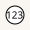                                                | `ellipse` via `ovalShield`                                  | Omit `rectWidth` for variable width.                                        |
| 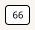                                   | `roundedRectangle` via `roundedRectShield`                  | Corner `radius` (default 2).                                                |
| 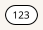                                                | `pill` via `pillShield`                                     | Capsule ends.                                                               |
|                                              | `diamond` via `diamondShield`                               |                                                                             |
| 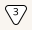                                       | `triangle` via `triangleDownShield`                         | `pointUp: false`.                                                           |
| 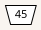 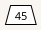   | `trapezoid` via `trapezoidDownShield` / `trapezoidUpShield` | `shortSideUp` selects orientation; helpers take `sideAngle` in **degrees**. |
| 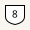                                     | `escutcheon` via `escutcheonDownShield`                     | Curved bottom; `yOffset` sets how deep the point is.                        |
| 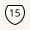                                       | `fishhead` via `fishheadDownShield`                         |                                                                             |
| 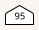                                         | `pentagon` via `pentagonUpShield`                           | Point up; `yOffset`, `sideAngle`, `radius1`, `radius2`.                     |
| 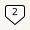 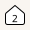 | `pentagon` via `homePlateDownShield` / `homePlateUpShield`  | Home-plate variant (`sideAngle: 0`, `pointUp` toggles).                     |
| 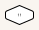                                    | `hexagonVertical` via `hexagonVerticalShield`               | Pointed top and bottom; `yOffset`.                                          |
|                                   | `hexagonHorizontal` via `hexagonHorizontalShield`           | Pointed sides; `sideAngle` in degrees on the helper.                        |
| 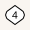                                    | `octagonVertical` via `octagonVerticalShield`               | `yOffset` and `sideAngle`.                                                  |
| 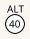                                       | any base + `banneredShield`                                 | Adds one or more banner strings above the shield.                           |

#### `shapeBlank.params` options

Each option below is illustrated with samples from `npm run docs:shape-samples`. Names are the ones on `ShapeBlankParams` (not older wiki synonyms like `fill` / `outline`).

##### `fillColor` / `strokeColor`

Interior and outline colors. `textColor` on the shield definition is separate.

| 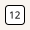       | 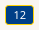        |
| ------------------------------------------------ | ------------------------------------------------ |
| `fillColor: "#ffffff"`, `strokeColor: "#000000"` | `fillColor: "#003f87"`, `strokeColor: "#ffd200"` |

##### `outlineWidth`

Outline thickness in CSS pixels (default `1`).

| 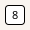 | 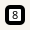 |
| ------------------------------------- | ------------------------------------- |
| `outlineWidth: 1`                     | `outlineWidth: 4`                     |

##### `rectWidth`

Omit for variable width (grows with the ref, clamped between the library min/max). Set a number for a fixed blank width.

|  | 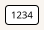 |
| ----------------------------------------------- | ---------------------------------------------- |
| variable, ref `5`                               | variable, ref `1234`                           |

| 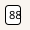 | 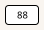 |
| -------------------------------------------------- | ------------------------------------------------ |
| `rectWidth: 16`                                    | `rectWidth: 34`                                  |

##### `radius`

Single corner radius for `roundedRectangle`, `diamond`, `triangle`, trapezoids, hex/octagon, and similar.

| 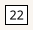 | 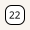 |
| ------------------------------------ | ------------------------------------ |
| `radius: 0`                          | `radius: 6`                          |

##### `radius1` / `radius2`

On `pentagon` (including home-plate helpers): `radius1` is the pointed end, `radius2` is the flat end.

| 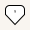 | 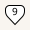 |
| ----------------------------------------- | ----------------------------------------- |
| `radius1: 0` (sharp point)                | `radius1: 8`                              |

| 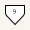 | 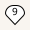 |
| ----------------------------------------- | ----------------------------------------- |
| `radius2: 0` (sharp flat corners)         | `radius2: 8`                              |

##### `yOffset`

How far top and/or bottom edges cut in toward a point. Higher means a deeper tip. Used by `escutcheon`, `pentagon`, `hexagonVertical`, and `octagonVertical`.

Escutcheon:

| 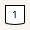 | 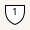 |
| ------------------------------------------------ | ------------------------------------------------- |
| `yOffset: 2`                                     | `yOffset: 14`                                     |

Vertical hexagon:

| 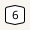 |  |
| ------------------------------------------ | ------------------------------------------ |
| `yOffset: 2`                               | `yOffset: 6`                               |

Pentagon tip:

| 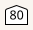 | 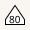 |
| ---------------------------------------------- | ----------------------------------------------- |
| `yOffset: 4`                                   | `yOffset: 14`                                   |

##### `sideAngle`

How far the sides lean from vertical. In raw `params` this is **radians**. The `*Shield` helpers take **degrees** and convert. Used by `trapezoid`, `pentagon`, `hexagonHorizontal`, and `octagonVertical`.

Trapezoid:

| 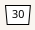 | 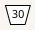 |
| -------------------------------------------- | --------------------------------------------- |
| 5°                                           | 15°                                           |

Horizontal hexagon:

| 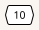 |  |
| --------------------------------------------- | --------------------------------------------- |
| 15°                                           | 40°                                           |

Pentagon with slanted sides:

| 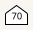 | 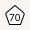 |
| ------------------------------------------------ | ------------------------------------------------- |
| 0°                                               | 20°                                               |

##### `pointUp`

Whether the pointed end is on top. Applies to `triangle`, `pentagon` / home-plate, and `fishhead`.

Triangle:

| 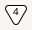 | 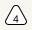 |
| -------------------------------------------------- | ------------------------------------------------- |
| `pointUp: false`                                   | `pointUp: true`                                   |

Fishhead:

| 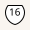 |  |
| -------------------------------------------------- | ------------------------------------------------- |
| `pointUp: false`                                   | `pointUp: true`                                   |

##### `shortSideUp`

Trapezoid only: which base is shorter.

| 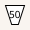 | 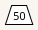 |
| --------------------------------------------- | -------------------------------------------- |
| `shortSideUp: false` (short side down)        | `shortSideUp: true` (short side up)          |

##### Banners (`banneredShield`)

Not a `params` field—`banners` on the shield definition draws labels above the blank. Prefer short labels (≤3 characters) so they stay readable at shield size.

|  |  |
| --------------------------------------- | --------------------------------------- |
| `["ALT"]`                               | `["ALT", "TRK"]`                        |

`banneredShield`’s third argument sets `bannerTextColor` (otherwise the global `options.bannerTextColor` is used):

| 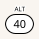 | 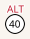 |
| ----------------------------------------------- | --------------------------------------------- |
| `bannerTextColor: "#000000"`                    | `bannerTextColor: "#bf2033"`                  |

Example using a helper:

```ts
import { pillShield, banneredShield } from "@americana/trailblazer";

const def = banneredShield(
  pillShield("#fff", "#000", "#000"),
  ["ALT"],
  "#bf2033"
);
```

##### `colorLighten` / `colorDarken`

These recolor **sprite** blanks (`spriteBlank`), not drawn `shapeBlank` shapes. Black pixels become `colorLighten`; white pixels become `colorDarken`. Americana uses lighten for historic US routes (including Route 66) with Pantone 469 brown (`#693f23`):

| 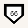 |   | 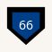   |
| ---------------------------------------------- | ----------------------------------------------- | ---------------------------------------------- |
| plain black/white badge                        | `colorLighten: "#693f23"` (+ brown `textColor`) | `colorDarken: "#003f87"` (+ white `textColor`) |

```ts
{
  spriteBlank: ["shield_badge_2", "shield_badge_3"],
  textColor: "#693f23",
  colorLighten: "#693f23",
  padding: { left: 8, right: 8, top: 10, bottom: 12 },
}
```

### Custom shield graphics

Besides the stock shapes, you can register a custom `drawFunc`. Bundled examples:

| Sample                        | `drawFunc` / helper                | Use                                                                                                       |
| ----------------------------- | ---------------------------------- | --------------------------------------------------------------------------------------------------------- |
| 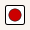 | `paBelt` via `paBeltShield`        | [Allegheny County belt](https://en.wikipedia.org/wiki/Allegheny_County_belt_system) icon (no route text). |
| 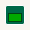 | `branson` via `bransonRouteShield` | Branson, Missouri colored route plaque (no route text).                                                   |

See `src/custom_shields.ts` for how those register with `registerDrawFunction`.

## Development

### Tests

Install dependencies, then run the Mocha suite:

```sh
npm ci
npm test
```

Headless shield rendering tests use [`canvas`](https://www.npmjs.com/package/canvas). On Linux you may need the usual Cairo/Pango system packages before `npm ci` succeeds.

### Shape sample SVGs

Drawn-shield illustrations in this README live under `media/shapes/`. Regenerate them after changing drawing helpers or the sample script:

```sh
npm run docs:shape-samples
```

### Test coverage

Coverage is collected with [c8](https://github.com/bcoe/c8) over the TypeScript sources under `src/`.

```sh
npm run test:coverage
```

This prints a summary in the terminal and writes a full HTML report to `coverage/`. Open the report locally:

```sh
open coverage/index.html   # macOS
xdg-open coverage/index.html   # Linux
```

The `coverage/` directory is gitignored. On pull requests, CI also:

- posts the coverage summary on the Actions job summary page (visible from the Checks tab)
- uploads the HTML report as a `coverage-report` workflow artifact

## Documentation

See [TypeDoc generated documentation](https://osm-americana.github.io/trailblazer/) for detailed API information.
